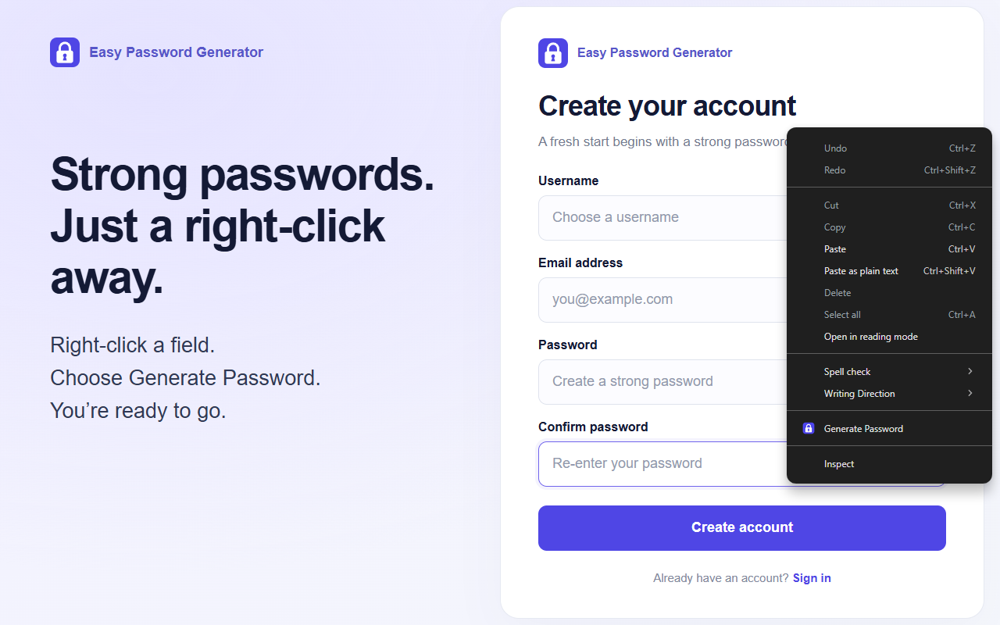
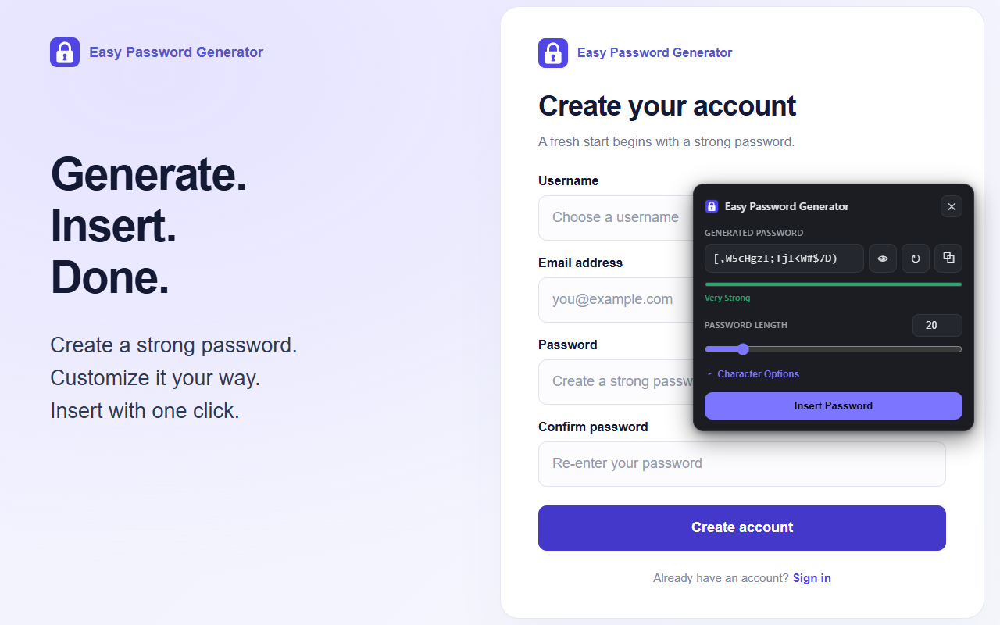

  

<h1 align="center">Easy Password Generator</h1>

  Generate strong, cryptographically secure passwords from any input field —
  with one right-click. 100% local &amp; private.

  

  

---

## Features

- **Right-click → Generate Password** on any editable field, or open it from the toolbar icon.
- **Cryptographically secure** generation (Web Crypto, unbiased sampling — never `Math.random()`).
- Adjustable **length 4–128** with a live, entropy-based **strength meter**.
- Character options: uppercase, lowercase, numbers, symbols, and *exclude ambiguous* (`O 0 I l 1`).
- **One-click Insert** into the field you clicked — works with plain HTML forms and React / Vue / Angular.
- Copy, Regenerate, Show/Hide, and a **draggable** panel.
- Light & dark themes that follow your system.
- **Private by design:** no accounts, no tracking, no analytics, no network requests. Nothing is stored or sent.
- **25 languages** with full right-to-left support for Arabic & Persian.

## Install

### From source (unpacked)

1. Download or clone this repository.
2. Open `chrome://extensions` and enable **Developer mode**.
3. Click **Load unpacked** and select the **`extension/`** folder.
4. Right-click any text field and choose **Generate Password**.

Everything that ships lives in `extension/`. No build step required.

## Privacy

Passwords are generated locally and are **never stored, logged, synced, or
transmitted**. Only your generator preferences (length and character types) are
saved on your device. See the full [Privacy Policy](PRIVACY.md).

## Developer

- **@buadamlaz** · [github.com/buadamlaz](https://github.com/buadamlaz)
- Website: [www.sezgin.net.tr](https://www.sezgin.net.tr)

## License

[MIT](LICENSE)
